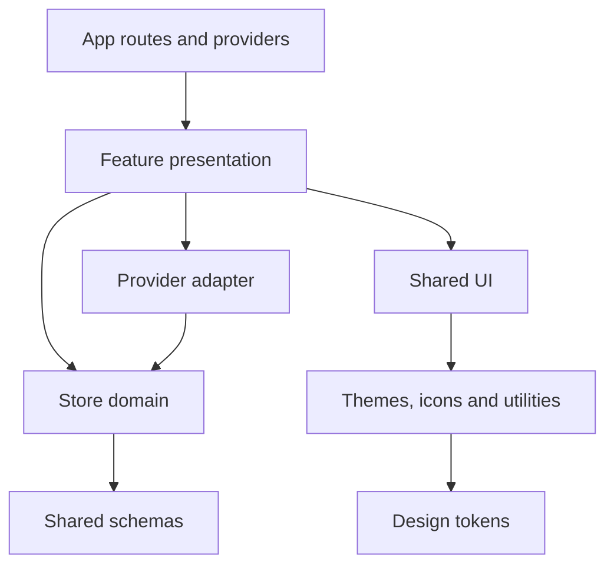

# Dependency rules

These rules describe the implemented website and the store checkpoint for #69.
They do not make source workspace packages published or stable APIs (#18).

| Boundary | Public entry point | Owns / allowed dependencies |
| --- | --- | --- |
| Website composition | `apps/egohygiene.io/src/app/router.tsx`, `providers.tsx`; browser/static adapters | Shared routes, provider composition and preview flag; browser adapter mounts, build-only `entry-server.tsx` renders; may compose features and packages |
| Store presentation | `features/store/index.ts` | React pages, router integration, metadata effects, artwork and gallery controls |
| Portable store behavior | `features/store/domain/index.ts` | Pure selectors, canonical paths and synthetic handoff eligibility; only local domain modules and `@egohygiene/schemas` |
| Synthetic provider normalization | `features/fourthwall-preview/adapter.ts` | Validates unknown provider input with `contract.ts`, maps to the domain contract; no HTTP, React, DOM or credentials |
| Canonical contracts | `@egohygiene/schemas` | Catalog v3, localized content/attribution, references, public projection, reviewed product readiness and purchase routes and disabled provider research; depends on Zod |
| Browser catalog input | `src/content/store/index.ts` | Receives `virtual:store-catalog`; browser consumers must use this entry point |
| Build / authoring adapter | `scripts/store-catalog.mts`, `vite-store-catalog.mts`, `build-public-site.mts` | Node validation/public projection; frozen public module shared by browser/static builds; static output stays behind the Node adapter |
| UI primitives | `@egohygiene/ui`, `@egohygiene/ui/styles.css` | Semantic component props; themes, icons and utilities; no catalog, provider, app or router imports |
| Independent visuals | `@egohygiene/visualizations`, `@egohygiene/visualizations/styles.css` | React visuals and their scoped CSS; stylesheet imports declared themes, never UI/app CSS; consumers import the style export explicitly |
| Theme and token layers | `@egohygiene/themes`, `@egohygiene/design-tokens` and their CSS exports | React theme preference adapter over semantic CSS variables and generated design tokens |
| Locale and configuration | `@egohygiene/i18n`, `@egohygiene/config` | App supplies messages/locale and explicit public environment input; do not read provider secrets here |

Feature paths in the table are relative to `apps/egohygiene.io/src/`.
Import packages through their manifest exports, not another package's internal
source files. Node authoring scripts intentionally use explicit `.ts` source
paths for the existing schemas; those scripts are repository tooling, not a
published consumer contract.

## Ownership

- Packages cannot depend on applications. Applications do not import another
  application's source. A feature must not import app composition to obtain state.
- Use the store domain entry point from presentation, adapters and the Node
  consumer. Domain code cannot import presentation, provider wire formats,
  `virtual:*`, React, Vite, routers, browser storage or Node APIs.
- Provider-specific response fields stop at the provider adapter. Canonical
  product IDs and URLs come from the validated catalog. Provider identifiers are
  separate handoff data, never replacement catalog identity.
- Keep site-specific artwork and presentation in the feature. Extract a shared
  primitive only when actual consumers agree on its semantic contract. Prefer
  `children`, message/content props and existing `Button` tones over provider
  switches, page names or a configuration language for component variants.
- There is no provider registry, dependency injection container or global store.
  A plain adapter object is selected by feature composition. Future I/O belongs
  in an explicit service at that boundary, with a deterministic fake for tests.

The former preview page consumed provider `unitPrice`, `attributes` and stock
fields directly. Its adapter now supplies a normalized synthetic offer and the
domain owns eligibility/subtotal rules. Catalog selectors were originally moved without
changing their ordering behavior. The subsequent [#54 checkpoint](../store/design-order-54.md)
resolves artwork references in declared order within that same portable boundary.

## Checks and limits

`pnpm check` retains workspace, package-export and dependency-cycle checks and
checks the portable store import boundary. `pnpm typecheck` includes a store
domain compilation without DOM or Node ambient types. `pnpm catalog:test` runs
the framework-neutral consumer alongside existing catalog/public-build tests.

These checks protect selected source boundaries, not every dependency in the
repository. They do not establish production provider qualification, published
package compatibility, complete localization, SSR safety or accessibility of
every page. See [extension contracts](store-extension-contracts.md),
[framework migration](framework-migration.md) and [ADR 0005](decisions/0005-portable-store-domain.md).
