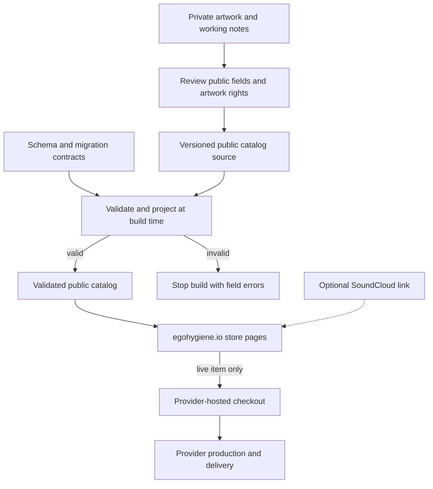

# Store v1 architecture

Status: reviewable checkpoint A plan, 2026-10-10. The consolidation direction is accepted in [roadmap #31](https://github.com/egohygiene/egohygiene.io/issues/31); the paths and contracts below are proposed implementation details. This document does not claim a deployed store.

Owner: `egohygiene/egohygiene.io`. Execution: [#32](https://github.com/egohygiene/egohygiene.io/issues/32), checkpoints A–C. See the [inventory and migration ledger](../migration/store-v1-consolidation.md) for pinned source evidence, preservation, and the next checkpoint.

## Decision

Build the storefront inside the existing `apps/egohygiene.io` application. Reuse the workspace's schema, configuration, UI, theme, and token packages. Keep one website deployment owner. A provider-hosted purchase destination handles checkout and fulfillment for the first live item.

The user-approved route is mock catalog first, then one live product whose provider can fund production from the customer payment. Fourthwall catalog is the first candidate to qualify in #38. Provider eligibility, supported products, payment timing, fees, payout requirements, and account setup must be verified there before activation; this architecture is not a claim that an account or product is ready.

This supersedes the separate-store-repository and comic-first recommendations in `incomprisllc/merch` research PR #5. Glitched Heart on a conventional black hoodie is the current first-product candidate. A comic, custom purse, blanket hoodie, sample pack, or beat license can follow without becoming a dependency of that first release.

## Current behavior, observed in source

At website commit `524aa4c139e926ca549f6bef067fc9ed40d15afb`:

- `apps/egohygiene.io/src/app/router.tsx` uses a browser router with public pages and a generic `:product` route.
- `src/content/products.ts` describes ecosystem projects, including a planned Store entry at `/store`. `ProductPage.tsx` renders project information, not purchasable merchandise.
- `packages/schemas/src/index.ts` exports three enums. The JSON Schema files allow arbitrary object properties; the type generator is empty. There is no merchandise contract or migration chain yet.
- `packages/config` exposes a browser-safe site name and URL. The shared UI, themes, and tokens already have implementations.
- The source merch repository has research, backlog issues, and scaffolds; it has no application or checkout implementation to merge.
- Preview/deploy workflows explicitly defer hosting setup. Source inspection does not establish current production availability.

| Surface | Current source behavior | Proposed Store v1 behavior |
| --- | --- | --- |
| `/store` | Generic ecosystem project placeholder | Catalog listing in the existing application |
| `/store/products/:slug` | No explicit route | Stable merchandise detail URL with preview/live/unavailable state |
| `/store/collections/:slug` | No explicit route | Curated realm, artist, design, or song collections |
| `/:product` | Ecosystem project information | Preserve for other projects; explicitly reserve `/store` and nested routes |
| Checkout | None | Verified external provider destination for a live item |
| SoundCloud | No integration in source | Optional, manually verified inbound link to a stable store destination |

Route names are proposed. The first store route slice belongs to #33/#36, with direct-navigation and asset-base behavior coordinated through #29. This plan does not force the entire #22 rendering migration or #20 Holon adoption into Store v1.

## Proposed publication and purchase flow

All nodes below describe the target. Provider and SoundCloud behavior require implementation-time verification.

The review boundary happens before material enters the public repository. A field omitted from the browser bundle can still be exposed in public Git history, so supplier negotiations, unpublished masters, credentials, customer data, and other private records never belong in this checkout or its commits. Any private source remains in the preserved private repository or an explicitly chosen private asset location; it is not a second website.

The build consumes only approved public input. It validates the supported schema version and references, then emits an allowlisted projection. It must reject invalid input rather than partially publishing a catalog. Revalidate the derived output to catch accidental fields. No runtime browser request reads the private repository, a supplier account, or provider credentials.

The customer follows a normal link to provider-hosted checkout. That provider collects payment and delivery details and owns its order workflow. The website does not collect card/address data or implement a shared cart, order router, payment backend, or marketplace payouts in v1. No paid order is needed for the mock stage.

## Proposed ownership and paths

| Concern | Owner / path | Boundary |
| --- | --- | --- |
| Store architecture | This document and root `DECISIONS.md` | Durable decisions and implementation ownership |
| Migration evidence | `docs/migration/store-v1-consolidation.md` | Original paths/revisions and explicit disposition |
| Publishable provider notes | Proposed `docs/research/merch/` | Dated public research with source and license notices |
| Public catalog authoring | Proposed `apps/egohygiene.io/src/content/store/` | Approved metadata only; fixture and live data share the contract |
| Catalog contracts | Extend `packages/schemas/src/` | One authoritative runtime schema; derive types, avoid parallel handwritten definitions |
| Store assembly and purchase-link policy | Proposed `apps/egohygiene.io/src/features/store/` | Site-specific composition; no provider credentials |
| Approved display images | Proposed `apps/egohygiene.io/public/store/` or reviewed public asset URLs | Optimized derivatives with provenance and usage permission |
| Shared presentation | Existing `packages/ui`, `themes`, `design-tokens`, `icons` | Reuse; do not publish packages solely for this store |
| Build/deployment | Existing app configuration; #29 | One deployer, explicit base paths, preview and rollback |
| Private masters and provider administration | Private source/asset storage and provider dashboard | Never bundled, committed publicly, or fetched by the public site |

No new database, service, package registry release, or paid hosting is required by this design. Hosting choice and any account costs still need confirmation through the owning implementation issues.

## Domain relationships

Design identity is independent of the physical item and the story in which it appears.

| Entity | Meaning | Example / relationship |
| --- | --- | --- |
| Design | Artwork identity and approved revision | Glitched Heart can exist without a song |
| Product | A purchasable item or honest preview | One hoodie references its design(s); changing collection membership does not duplicate it |
| Variant | Customer-selectable physical option | Size/color and explicit provider mapping when live |
| Brand / artist | Attribution and ownership | Ego Hygiene and `.play()` remain explicit, separate references |
| Collection | Curated merchandising grouping | Realm, artist feature, song world, or standalone design collection |
| Song / character / appearance | Optional creative context | A character can wear a design in multiple videos; this does not invent song ownership |
| Purchase destination | Reviewed provider handoff | Provider/product/variant identity, URL, and verification record |

Allow many-to-many membership where needed: one design can appear on several products; one product can feature in several collections; song and character associations are optional. Use stable IDs for identity and changeable slugs for URLs, with redirect policy if a published slug changes. Keep ecosystem `EcosystemProduct` records distinct from merchandise products.

The minimum fixture set in #34 is a standalone Glitched Heart design, a song-associated collection, and a future comic preview. Mock fixtures must be visibly labeled and cannot fabricate a real artist collaboration, stock availability, price, or live purchase destination. Sample packs and beat licensing remain separately tracked future work; no delivery or licensing system is being built here.

## Contract evolution and purchase states

Choose the authoritative schema representation in #34; the existing Zod package is the starting point. Runtime validation, inferred types, public projection, and migration fixtures must agree. Adding a schema field alone is not proof that old catalog data remains compatible.

- Give the catalog an explicit version and a supported-version policy. Breaking changes require a deterministic migration chain and old/new fixture evidence. Reject unknown versions.
- Enforce unique IDs/slugs, valid design/collection/artist references, artwork revision, and exhaustive purchase states.
- `preview`: requires honest preview labeling; no purchase action, price, or provider URL is required. Authoring-only drafts never enter the public projection.
- `live`: requires reviewed artwork, valid provider/product/variant mapping, a supported HTTPS destination, accurate customer information, and recorded handoff verification.
- `unavailable`: may preserve a public detail page but must not initiate checkout. A previously live item can be deactivated through catalog configuration.
- If displaying prices, use currency plus integer minor units and disclose the provider checkout as the authority for the final total. Never show a sample price as a live quote.
- Migration tests preserve stable identity, explicitly address removed/renamed fields, and exercise invalid references and unsupported versions. Roll back source data and compatible schema together.

## Provider and SoundCloud boundaries

Adding another provider later should extend the reviewed purchase configuration and URL policy, not fork the website or force every product into one supplier. A preview can have no provider. Future API fulfillment or a shared cart would require a new decision because it changes payment, order, customer-data, and failure-handling responsibilities.

SoundCloud is an optional entry point, not the catalog's source of truth. In #39, verify current account eligibility and the actual storefront-link UX, then link a chosen track to the intended live collection or product destination and check it as a visitor. A track linking to standalone merch does not require claiming the design originated from that song. No SoundCloud API integration or paid-plan assumption is made here.

## Delivery and evidence

| Issue | Bounded responsibility |
| --- | --- |
| #32 | Inventory, reviewed migration, preservation, and reversible retirement |
| #33 / #29 | App/toolchain baseline and routing; hosting owner resolves deployment |
| #34 | Versioned catalog contracts, projection, and migration proof |
| #35–#36 | Brand foundation, professional mock listing/detail/collection experiences |
| #37 | Contract, customer journey, accessibility, and regression qualification |
| #38 | One provider-qualified live product and verified checkout handoff |
| #39 | Approved publication and visitor-verified SoundCloud entry point |

Every checkpoint ends with a reviewable draft PR and chat sync. Milestone completion proves the live purchase handoff; any paid transaction, sample quality, or physical fulfillment evidence is reported separately. For activation rollback, restore the last compatible catalog/build or set the item unavailable; do not silently route customers to a substitute product.
