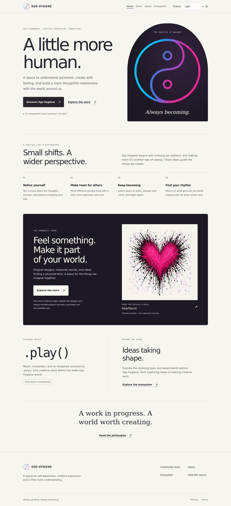

# Landing page and shared shell — #35 review

Status: **rendered proposal for maintainer review**, 2026-10-17 UTC.
Owner: [issue #35](https://github.com/egohygiene/egohygiene.io/issues/35).
This checkpoint applies the [launch direction](../architecture/store-launch-plan.md)
to the existing website. It does not change the application owner or host.

## Visual direction

Ego Hygiene leads with its purpose: self-awareness, creative expression and
connection. The root page pairs large editorial typography and a warm paper
palette with the existing cyan/magenta identity. A dark community-store panel
provides a clear entrance to `/store`. The approved heartburst artwork links to
its canonical design page and is explicitly an artwork preview, not a garment
mockup or a product for sale. `.play()` appears as one featured creative voice
within the wider host; no fictional catalog record is attributed to that artist.

The header retains Home, Store, About and Ecosystem. Privacy and Terms remain in
the footer. The mobile navigation is a disclosure, supports Escape and focus
return, closes on route changes or focus leaving the header, and scrolls within
a short viewport. The skip link moves focus to main content without hiding its
opening text behind the sticky header. Existing store URLs, theme behavior and
disabled purchase states remain intact.

The design uses system sans-serif/monospace and a small system-serif accent;
there are no new fonts or dependencies. Site light colors map to existing
semantic tokens. Dark and high-contrast themes remain available. Artwork keeps
its aspect ratio; the hero illustration and decorative orbits are static.

## Rendered evidence

Full-page captures use Chromium 153.0.8010.0, device scale 1. JPEG quality 82 is
an export choice for review size; the underlying artwork exports are unchanged.
The implementation revision is pinned in the [provenance ledger](../context/provenance.md).

| State | Viewport | Capture |
| --- | --- | --- |
| Previous home | 1440 × 1080 | [Desktop before](landing-shell-35/before-desktop.jpg) |
| Previous home | 390 × 844 | [Phone before](landing-shell-35/before-phone.jpg) |
| Proposed light | 1440 × 900 | [Desktop](landing-shell-35/desktop.jpg) |
| Proposed light | 390 × 900 | [Phone](landing-shell-35/phone.jpg) |
| Proposed light | 820 × 900 | [Tablet](landing-shell-35/tablet.jpg) |
| High contrast | 1440 × 900 | [High contrast](landing-shell-35/high-contrast.jpg) |
| Expanded test copy | 390 × 900 | [Long text](landing-shell-35/expanded-phone.jpg) |
| RTL test copy | 390 × 900 | [RTL](landing-shell-35/rtl-phone.jpg) |

The previous application source is `db634b887ede348ce85d9c03af789467ab535dcf`;
later planning/ownership commits do not change that application baseline.
Before views use its production build. Current review captures use Vite locally;
the production build is separately exercised by the browser journeys below.

## Small contracts that keep this extensible

- `src/content/landing.ts` holds only the featured stable design ID. Artwork,
  title and canonical destination come from the validated public catalog and
  portable domain entry point. Missing/failed artwork keeps a useful store link.
- New landing and shell copy lives in the existing English message resources.
  ThemeToggle accepts translated labels while retaining compatible defaults.
  The shared lookup now returns only own string leaves and falls back safely for
  missing paths, namespace objects and inherited keys; this fixes the small
  #51 prerequisite encountered here.
- `src/test/locale-fixtures.ts` creates expanded and RTL stress dictionaries for
  tests. These are not real translations or supported locales. Catalog text is
  unchanged. No locale selector or test controls ship in the production app.
- The same app providers, router and public catalog remain the integration
  boundary. There is no new store implementation, provider adapter or framework.

Source paths above are relative to `apps/egohygiene.io/`. Existing brand source
and export receipts remain authoritative: [identity provenance](../../assets/identity/source/provenance.json),
[identity notice](../../assets/identity/NOTICE.txt), and
[heartburst record](../../assets/designs/heartburst/README.md). Code licensing
does not grant artwork rights; #59 retains the existing licensing reconciliation.

## Verification and limits

Local runtime: Node 24.21.0, pnpm 11.28.5, frozen lockfile. The production build,
catalog validation and app/store/domain TypeScript checks pass. Focused unit
checks cover home metadata, public-design routing, image failure, shell behavior,
translation lookup and compatible UI primitives. Existing accessibility role
checks pass; they are not a complete accessibility audit.

Production browser coverage includes the home navigation, short-screen menu,
skip link, existing catalog/search/details, keyboard/reduced-motion behavior,
three themes and denied-storage recovery. Initial mobile store failures were
stale locators for the old navigation label; the tests now use the actual
Open/Close names and pass. Detailed counts are in the ledger.

Rendered checks cover 320, 390, 820, 1024, 1440 and 1920 CSS-pixel widths,
three themes, expanded copy and RTL, plus short-height menus. They found and
resolved translated-label clipping at the hero arch, off-screen menu controls
and the skip target's sticky-header offset. No page errors, missing loaded
images or document overflow remained in those cases. This is a bounded Chromium
desktop/touch-emulation review: physical devices, Safari/Firefox, screen readers,
browser zoom at 200–400%, and a complete contrast audit remain with #37/#49/#70.

New copy is ready for #64; full-site localization and catalog translation (#65)
remain open. Storybook parity and a supported locale selector are not claimed.
Hosted CI, deployment, live checkout and provider qualification were not used
as completion gates for this local checkpoint. No paid service was provisioned.

## Next review

Alan reviews the rendered visual direction before this issue is closed or the
store is expanded. The proposed next slice is #62: curated standalone designs
and a distinct song-merch discovery path. Comics/Alpal placeholders, live product
setup and additional design intake follow their own bounded tasks. The current
root/store distinction already leaves room for them.
