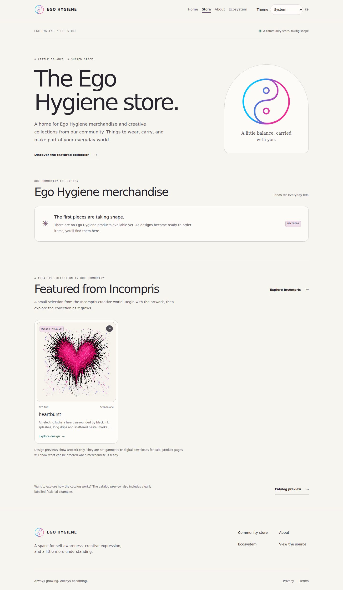
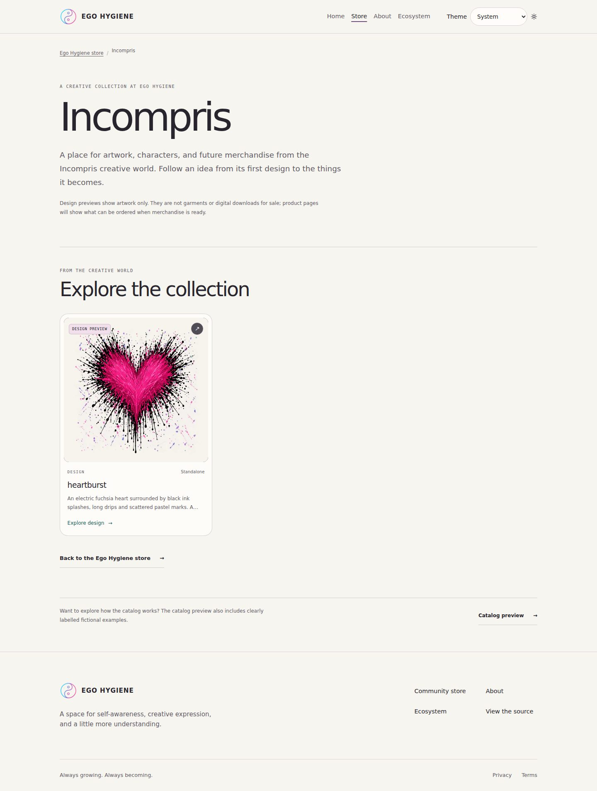

# Storefront checkpoint A — Ego Hygiene and Incompris

This is checkpoint A of [#62](https://github.com/egohygiene/egohygiene.io/issues/62).
The maintainer requested a draft PR and a sync before checkpoint B. There is no
merge, deployment or real commerce activation in this checkpoint.

## What to review

- `/store`: Ego Hygiene leads, with its own upcoming merchandise state. A manually
  selected **Featured from Incompris** row leads into the collection or straight
  to the existing heartburst design page.
- `/store/incompris`: a working collection destination with the same canonical
  artwork card. No artist page is linked before checkpoint B implements it.
- `/store/catalog`: the existing full catalog preview, with fictional examples
  explicitly separated from the curated shop. Existing filtered `/store` links
  still resolve, preserving query parameters and old catalog anchors.

The only selected artwork is `design-heartburst`. It is an approved display
proof, not a purchasable garment or print-ready master. Its song/artist contexts
remain empty. Existing [asset provenance](../../assets/designs/heartburst/README.md)
and [identity provenance](../../assets/identity/source/provenance.json) apply;
this checkpoint generates no artwork and imports no private master.

## Local review

Use Node 24.21.0 and pnpm 11.28.5, as pinned in the repository. From the branch:

```sh
pnpm install --frozen-lockfile
pnpm build
pnpm --filter @egohygiene/egohygiene.io preview --host 0.0.0.0 --port 4173
```

Open `http://localhost:4173/store`, then follow **Explore Incompris**. The existing
`task preview:store` also includes the isolated synthetic Fourthwall tryout;
that route is absent from the normal production build above.

## Add or reorder a selection

1. Add approved public content through the existing
   [catalog authoring contract](../store/catalog-authoring.md). Keep one canonical
   product ID across every view. Review asset publication and purchase state
   separately; putting an ID in a list never approves checkout.
2. Edit
   `apps/egohygiene.io/src/content/store/storefront-curation.json`. Its version-1
   arrays are `egoHygieneEntryIds`, `incomprisEntryIds` and
   `featuredIncomprisEntryIds`. Order is explicit, not filename or title order.
3. Featured Incompris IDs must also appear in `incomprisEntryIds`. A design,
   product or collection can appear in several lists. Duplicate IDs within one
   list, contexts, drafts and unknown IDs fail validation.
4. Run `pnpm catalog:validate`, the relevant contract checks and `pnpm build`.
   Review both routes, the canonical detail page, the image fallback and the
   actual preview/unavailable/live label. Dev reload watches the manifest too.

This manifest changes placement only. Do not infer `.play()` or song associations
from the Incompris page. Artist/song authoring remains checkpoint B. Empty lists
are supported; use them until real approved content is available.

## Contract and verification

[ADR 0008](../architecture/decisions/0008-curated-storefront-views.md) explains the
separate editorial contract, public projection and old-link compatibility.
Local verification on 2026-10-17 passes:

| Check | Result |
| --- | --- |
| `pnpm build` | Catalog and curation validate; 173 modules; JS 424.67 kB / gzip 127.87 kB, CSS 46.88 kB / gzip 9.45 kB |
| `pnpm typecheck` | App, Node catalog, and portable domain pass |
| `pnpm catalog:test` | 47 pass, including strict curation references, CLI guards, public-build exclusion, and Vite reload/error recovery |
| Focused `pnpm test:unit` | 28 pass across storefront pages, artwork, gallery, selectors, and homepage |
| `pnpm test:store` | All 23 pass; the five new storefront journeys also pass after the last UI rebuild |
| Portable import boundary | 11 modules pass |
| Scoped formatting / whitespace | Pass; existing component lint warnings and Playwright environment warnings remain, no new lint errors |
| Independent review | No substantive findings in the curation, projection, routing, or purchase boundaries |

Browser journeys cover the canonical shop → Incompris → heartburst flow,
reload/Back, old filtered and anchored URLs, the catalog preview entrance,
keyboard/reduced motion, and widths 320/390/820/1440. The existing 18 store/theme
cases retain their gallery, modal, search, purchase-state and storage coverage.
Shared card labels and artwork fallbacks now use message resources; older detail
and generic catalog copy still belongs to the broader localization work.

A temporary, unshipped QA host rendered four fictional selected cards with
expanded and synthetic RTL dictionaries at 320/390/1440. All six scenarios kept
both page types within the viewport and retained all four cards. The featured
row accepted focus and native ArrowRight/ArrowLeft scrolling in the appropriate
direction. The actual public selection has one card, so it does not need overflow.
The host and its fixture were removed; no unsupported locale was added to the app.

Chromium 153.0.8010.0 only. These checks do not certify physical devices, Safari,
screen readers, all zoom modes, full accessibility, hosted CI, production routing,
or real-provider checkout. No dependency or lockfile was changed. Existing broad
CI repair remains separate; no checks were disabled.

## Rendered checkpoint

These are actual production-route captures, full page at JPEG quality 82. The
[capture manifest](storefront-62a/captures.json) records dimensions, SHA-256 and
empty page/image error lists. They were visually inspected at desktop and phone
sizes. Empty merchandise space is intentional until approved garments exist.

| Route | Desktop | Phone |
| --- | --- | --- |
| Main shop | [1440px](storefront-62a/store-desktop.jpg) | [390px](storefront-62a/store-phone.jpg) |
| Incompris | [1440px](storefront-62a/incompris-desktop.jpg) | [390px](storefront-62a/incompris-phone.jpg) |




