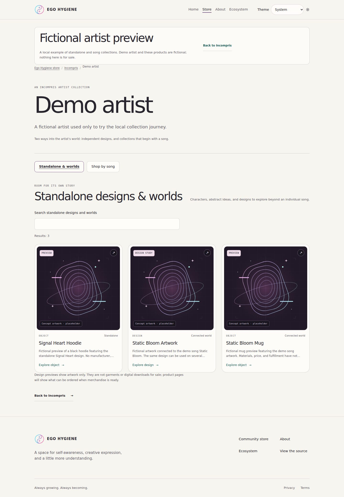

# Storefront checkpoint B — Artist and song collections

This extends [#62](https://github.com/egohygiene/egohygiene.io/issues/62) in
[draft PR #78](https://github.com/egohygiene/egohygiene.io/pull/78), on
`feat/storefront-checkpoint-62a`. The maintainer authorized checkpoint B after
the [checkpoint A](storefront-62a.md) review. Stop for a sync before checkpoint C;
this is not a merge, deployment or real-commerce activation.

## What to review

| Destination | Behavior |
| --- | --- |
| `/store/incompris` | Existing selected artwork plus an entrance to `.play()` |
| `/store/incompris/artists/play` | Reusable artist page, initially showing **Standalone & worlds** |
| `/store/incompris/artists/play?view=songs` | Distinct **Shop by song** view, suitable for sharing |
| `/store/collections/:slug` | Existing canonical collection destination for an individual song; suitable for a SoundCloud track link |
| `/store/preview/artists/demo-artist` | Isolated local preview proving populated standalone/song flows with a clearly fictional artist |

The real `.play()` page intentionally has no selected merchandise yet. Heartburst
remains in Incompris with no invented artist/song association or garment. Existing
fictional products retain their preview/unavailable states. There is no new
artwork, music metadata intake, account, provider route or checkout permission.

The preview reuses the canonical Signal Heart hoodie as a standalone example,
and the Static Bloom design/mug in standalone discovery and its song collection.
The mug resolves to the same `/store/products/static-bloom-mug` page from either
view. The fictional artist, its additional fixture and route are excluded from
normal builds. The existing public demo catalog remains as it was before B.

## Try it locally

Use the pinned Node 24.21.0 and pnpm 11.28.5. For the real public routes:

```sh
pnpm install --frozen-lockfile
pnpm build
pnpm --filter @egohygiene/egohygiene.io preview --host 0.0.0.0 --port 4173
```

Open `http://localhost:4173/store/incompris`, then `.play()`. Switch views, search,
reload, clear the query and use browser Back. View changes create history entries;
typing replaces the current entry. Unrelated query parameters are preserved.
An unknown artist has a useful return to Incompris.

To see the populated demonstration, run the existing isolated preview:

```sh
mise exec node@24.21.0 -- task preview:store
```

Follow **Try the fictional artist example** from Incompris, or open
`http://127.0.0.1:4173/store/preview/artists/demo-artist`. Use a separate stopped
server/session if port 4173 is occupied. The preview has a visible fictional
banner and makes no sales. Its canonical collection page belongs to the original
public demo catalog; browser Back returns to the filtered fictional artist view.
It does not add a fictional artist return link to the normal public collection.

## Content contract

[ADR 0008](../architecture/decisions/0008-curated-storefront-views.md) records the
additive version-1 curation extension. Catalog schema version 1 is unchanged.
Existing curation input without `artists` still parses as an empty artist list.

Each curated artist references one public `contextType: "artist"` record, with
ordered `standaloneEntryIds` and `songCollectionIds`, both optional and empty by
default. Standalone entries can be public designs, products or collections; song
entries must be public collections with a direct public song context. Missing,
draft, wrong-kind and duplicate references fail validation. Intentional overlap
between views or artists is allowed without duplicating catalog records.

Adding something to a view establishes discovery placement, not authorship or
ownership. Keep canonical IDs and slugs stable after sharing links. Content
descriptions remain catalog content; the new interface strings use the existing
message provider. Full catalog translation is separate work.

See the [authoring guide](../store/catalog-authoring.md) for the exact JSON shape
and [extension contracts](../architecture/store-extension-contracts.md) for the
portable selector and React boundaries. No runtime fetch from a private catalog
is needed. An empty artist or song collection is valid; do not manufacture data
just to fill a page. Restoring pre-B code requires restoring pre-B curation too,
because older strict readers reject the new `artists` field.

## Local verification

Local results on 2026-10-17, using the pinned runtime:

| Check | Result |
| --- | --- |
| Normal `pnpm build` | Pass; catalog/curation validate; 177 modules, JS 434.00 kB / gzip 129.95 kB, CSS 49.50 kB / gzip 9.79 kB |
| Isolated `node scripts/store-environment.mjs build` | Pass; 184 modules, including local preview features |
| `pnpm typecheck` | App, Node catalog and portable domain pass |
| `pnpm catalog:test` | 55 pass, including eight new artist/default/reference/identity cases |
| Focused `pnpm test:unit` | 40 pass: artist 10, storefront 8, preview fixture 2, artwork 5, gallery 6, catalog selectors 5, homepage 4 |
| `pnpm test:store` | All 27 pass, including four new artist journeys |
| `pnpm test:store:preview` | All five pass, including three new populated artist journeys |
| Portable import boundary | 12 modules pass |
| Normal-build exclusion | Additional fictional artist IDs and both local preview route prefixes absent from built JS/HTML |
| Scoped formatting and whitespace | Pass with existing detail-component/Playwright warnings; no new lint errors |
| Independent source review | No substantive findings in references, public projection, canonical identity, route state or preview isolation |

The preview suite initially exposed an older Fourthwall test expecting its link
directly on `/store`. It now follows the checkpoint A **Catalog preview** entrance
before opening the demo; all five preview tests were rerun successfully. No app
behavior or gate was weakened to fix that test.

Browser coverage includes Incompris → real artist, both empty views, URL search,
reload/Back, unknown-artist recovery, keyboard/reduced motion at 320px, and a
populated fixture at 390px. The fixture proves standalone/song overlap, copied
canonical collection links, shared product identity and preserved preview
purchase labels. Existing store/theme and Fourthwall journeys still pass.

### Rendered checkpoint

These actual browser captures were visually inspected. The
[capture manifest](storefront-62b/captures.json) records normal versus isolated
build, route, viewport/full-page dimensions, SHA-256, byte counts and empty
page/image error lists. Three JPEGs total 387,029 bytes, quality 82, no image
manipulation. Chromium 153.0.8010.0 only.

| View | Capture |
| --- | --- |
| Real `.play()` song view, intentionally empty | [390px phone](storefront-62b/play-songs-phone.jpg) |
| Fictional standalone preview | [1440px desktop](storefront-62b/demo-standalone-desktop.jpg) |
| Fictional song collection preview | [390px phone](storefront-62b/demo-songs-phone.jpg) |



The [context ledger](../context/provenance.md) records the implementation receipt;
the captures represent that application source. Later receipt-only documentation
does not change the rendered application.

## Remaining boundary

Checkpoint C remains for the agreed broader journey/content review, including
additional empty/missing-image fixtures, forward navigation, tablet/long-text/RTL
qualification and a consolidated repeatable content-addition walkthrough. B's
focused tests do not close that checklist or the wider accessibility/localization
issues. No physical-device, Safari, screen-reader, hosted-CI, production-routing
or live-provider qualification is claimed. No dependency/lockfile changed and no
gate was disabled. Sync with Alan before beginning C.
